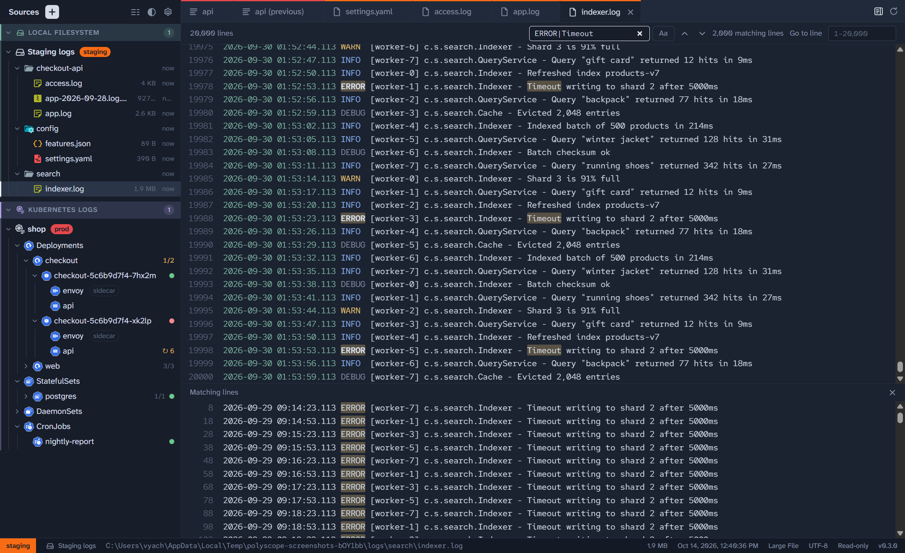

# Reading files and logs

Everything opens read-only in the viewer on the right, in the same editor that powers VS Code.

## Tabs

- **Click** a file or container to **preview** it. A preview tab (in italics) is replaced by the next one you preview.
- **Double-click** it, or double-click its tab, to keep it open in a tab of its own.
- Right-click a tab for **Reload**, **Follow** (for files that can grow), **Close**, **Close Others** and **Close All**.
- The buttons at the right of the tab bar show or hide the **Minimap**, and **Reload** the active tab.

Each tab carries its Source's Environment colour. The status bar shows the active tab's Environment, Source and path, and for files its size, modified time, encoding and language.

### Panes

To read two things side by side, say prod's and staging's logs of one service, right-click a file or log in the sidebar and choose **Open to the Side**. It opens in a second **Pane** to the right of the first, each half the viewer's width. With two Panes open already, **Open to the Side** opens it in the other one.

- Each Pane has its own tab bar, preview tab, **Minimap** and **Reload** buttons, and tab menu. **Close Others** and **Close All** act on that Pane only.
- The Pane you last clicked or moved into is the active one. Its tab bar has a glint along the top, and the other Pane's active tab is dimmed. <kbd>Ctrl</kbd>/<kbd>⌘</kbd>+<kbd>1</kbd> moves into the first Pane and <kbd>Ctrl</kbd>/<kbd>⌘</kbd>+<kbd>2</kbd> into the second; with one Pane, <kbd>Ctrl</kbd>/<kbd>⌘</kbd>+<kbd>2</kbd> does nothing.
- Clicking a file or log in the sidebar, or <kbd>Space</kbd>/<kbd>Enter</kbd> on it, opens it in the active Pane. The status bar describes the active Pane's tab, and the tab shortcuts below act within it.
- A file or log is open in only one tab at a time. Opening one that's open already, from the sidebar or with **Open to the Side**, brings up its tab in whichever Pane holds it.
- To move a tab you already have open to the other Pane, choose **Move to Other Pane** in its menu, or drag it onto the other Pane's tab bar, where it lands where you drop it. With one Pane, **Move to Other Pane** opens a second Pane for it. <kbd>Ctrl</kbd>/<kbd>⌘</kbd>+<kbd>\</kbd> moves the active tab into a new Pane. A moved tab keeps what it shows, its Follow and its view settings. A preview tab stays one, and the other Pane's own preview tab is kept, as a tab of its own.
- <kbd>Ctrl</kbd>/<kbd>⌘</kbd>+<kbd>\</kbd> does nothing when the active tab is its Pane's only tab, or when there are two Panes already; nor does **Move to Other Pane** show on a lone Pane's only tab.
- A Pane closes as soon as it has no tabs left, moved out or closed, and the other one becomes active. Disconnecting a Source leaves its tabs, and so their Panes, open.
- Every launch starts with one Pane.

## Files

Polyscope highlights a file by its name: YAML, JSON, XML, source code, and logs, whose timestamps and numbers are coloured, and each line's level: the one its level field says (`level=warn`, `"level":30`), or the first level word near its start, as popular loggers write them (`INFO`, `[12:00:00 WRN]`, `|Error|`, `fail:`, klog's `E1029 …`), not one later in its message. It also handles:

- **Compressed files**: `.gz` and `.zst` files are shown decompressed, highlighted by the name inside (`app.log.gz` as a log).
- **Encodings**: the encoding is detected. Click it in the status bar to reopen the file as UTF-8, UTF-16 or Latin-1.
- **Language**: click it in the status bar to highlight the file as another language.
- **Binary files**: shown as a size, with **Show as hex** to see the bytes.
- **Wrap**: the **Wrap** button at the top right wraps long lines.
- **Log Levels**: a file highlighted as a log has the same **Error**, **Warning**, **Info** and **Debug** buttons as a log view, to show only some levels' lines. See below. In VS Code, a file opens in VS Code's own editor, which doesn't have them.

To watch a growing file on a Local Filesystem, SSH Files or Kubernetes Files Source, turn on **Follow** from its tab's menu, or right-click it in the sidebar. New lines appear as they're written.

### Save a copy

To keep a file on your computer, say to attach it to a bug report or keep it before it rotates away, right-click it in the sidebar, or use the button at the top of the file, and choose **Save a copy…**. It works for files from every kind of Source. Polyscope asks where to save it, suggesting the file's name in your Downloads folder.

- The copy has the file's bytes exactly as they're stored: a `.gz` or `.zst` file stays compressed.
- A bar at the foot of the window shows how it's going. A large file is read a piece at a time, so it doesn't fill up memory. **Cancel** stops the save.
- A save that's cancelled, or that fails partway (say, when the connection drops), leaves nothing behind and says why. A file you chose to replace stays as it was.
- Only the place you chose is written to. Polyscope never changes the Source itself.

## Logs

A container's log, a CloudWatch log, or a systemd unit's journal opens with a toolbar:

- **Last N lines**: how much of the log to fetch and keep: 1K, 10K (the default, set in **Settings**), 50K, 100K, **All**, or a number you type. Choosing **All** for a log over the Large File threshold asks first.
- **Since**, for Docker and Kubernetes containers, Kubernetes Events, CloudWatch logs and systemd units: show only the lines logged since a time: **Any time** (the default), **15 min**, **1 h**, **6 h** or **24 h** ago, or a date and time you type, like `2026-10-18 09:00`, or a time alone, like `09:00`, for today. It's read in local time or, with **UTC** on, in UTC. **Last N lines** still caps how many lines show, and **All** shows every line since then, asking first only if those are over the Large File threshold. **Follow** goes on from the last line shown, and a Kubernetes container's **Previous Log** shows only its lines since then too. Each new tab starts at **Any time**.
- **Load earlier**, for CloudWatch logs: add the lines before the first one shown, as many as **Last N lines** says. With a **Since**, it goes back only as far as the Since, and once it gets there it's no longer offered: there's nothing earlier to show.
- **Follow**: show new lines as they're logged. **Pause** holds new lines back while you read, and **Resume** shows them.
- **Previous**: show the container's **Previous Log**, the log of its run before it last restarted, in the same tab, marked "(previous)". It has ended, so there's nothing to Follow; turn **Previous** off to go back to the current log, Following it again. It's available once the container has restarted, which a Follow notices as it happens; Kubernetes keeps only the run just before the current one, and not always that.
- **Events**, for a Kubernetes container: show its pod's **Events** in the same tab, titled like `api-7d9f-x2k · Events`, Followed, with the same **Since** and **Last N lines**. A container whose log is empty because it never started (`ImagePullBackOff`, say) shows why: `Failed to pull image …`. It's there whether or not the container has a **Previous Log**, and every container of a pod shows the same pod's Events; a Workload's are on its row's **Show Events**. Turn **Events** off to go back to the container's log, Following it again, or turn **Previous** on for its Previous Log.
- **Timestamps**: start each line with when it was logged, in local time or, with **UTC**, in UTC.
- **Wrap**: wrap long lines.
- **Error**, **Warning**, **Info**, **Debug**: show or hide each level's lines. See below.
- **Save a copy…**: keep the log on your computer, say to attach it to a bug report. See below.

The toolbar stays on one line. When the log view is too narrow for all of it, the controls used least fold into a **…** menu at its end, the first to go being **Save a copy…**, then **UTC**, **Load earlier**, **Since**, **Last N lines**, **Timestamps**, **Wrap**, **Previous** and **Events**. The Level Filter, **Follow** and **Pause** always stay in view. Click **…** (or focus it and press <kbd>Enter</kbd>) to show the folded controls: they work just as in the toolbar, showing which are on, and <kbd>Tab</kbd> moves through them. <kbd>Esc</kbd> or a click elsewhere closes the menu. With room again, the toolbar unfolds. Narrower still than the Level Filter, **Follow**, **Pause** and **…** together, the toolbar scrolls across.

Colour codes and other ANSI escape sequences that loggers write into their output are removed, from logs, files that open as logs (`.log`, `.out`, `.err`) and Large Files alike, so a log shows, is searched and is saved as plain text; **Save a copy…** of a file keeps the file's original bytes, sequences and all.

### Showing only some Log Levels

The **Error**, **Warning**, **Info** and **Debug** buttons show or hide the lines of each level, each button saying how many there are. All four start on in each new tab; turn **Debug** off to cut the noise, or all but **Error** to see only what went wrong.

- A line with no level of its own, like a stack trace's or the rest of a message over several lines, goes with the line with a level above it: hide errors and their stack traces go too.
- Lines before the first with a level, and the log's marks (and the lines after a mark, until one with a level), always show.
- The lines shown keep their numbers, so a gap in the numbers shows where lines are hidden.
- It only hides lines already read: **Last N lines** and **Since** count every line, shown or not, and turning a level back on shows its lines straight away. A **Follow**'s new lines are shown or hidden as they come; while **Paused**, the lines held back aren't counted until you **Resume**.
- Search, copying and **Save a copy…** cover only the lines shown.
- It stays as it is when you switch to the **Previous Log** and back. With all four off, only the lines with no level show, and the log says so.

While following, the log marks what happened in line: a container restarting, Kubernetes Events starting over, the connection dropping and recovering, or the container, pod, CloudWatch log or Source going away.

### Kubernetes Events

**Events**, at the top of a Kubernetes Logs Source's tree, opens every Event in its namespace as a log, one line per Event:

```
[Warning] BackOff pod/api-7d9f-x2k: Back-off restarting failed container (×14)
```

Right-click a pod or a Workload in the tree and choose **Show Events** to open a tab of just its Events, titled like `api-7d9f-x2k · Events`. A pod's are that pod's alone; a Workload's are its own and those of everything it owns or owned: a Deployment's ReplicaSets, a CronJob's Jobs, and their pods, those since deleted included (told by the names Kubernetes gave them). So a Deployment whose ReplicaSet can't create pods (`FailedCreate`, say, for an exceeded quota) shows why, though there's no pod to open. A row standing in for a Workload's only pod shows the Workload's Events. Followed, a Workload's Events take in those of the pods, ReplicaSets and Jobs it creates meanwhile. These Events aren't listed in the tree, and read like the namespace's in every other way. A container's log view can switch to its pod's Events too, with **Events** in its toolbar.

- Each line gives the Event's type (**Normal** or **Warning**), its reason, the object it's about as `kind/name`, and its message, then how many times it has happened when that's more than once.
- Lines go by when each Event was last seen, oldest first. **Timestamps** shows that time.
- Warning Events are coloured and filtered as warnings, Normal ones as info.
- **Since** keeps the Events last seen since then, even ones first seen before, and **Last N lines** counts one line per Event.
- Events have no **Previous** log.
- **Follow** adds a line each time an Event happens, and again each time one happens again, with its new count and when it was last seen. Lines already shown stay as they are.
- Kubernetes closes a watch on Events now and then; the Follow carries on from where it was without a word. If it can't, having been away too long ("410 Gone"), it starts over from the last line shown and marks it: `── following started over, so Events around here may be missing or repeated ──`.
- Following Events needs permission to watch them too (the `watch` verb on `events`).
- Kubernetes keeps Events for about an hour by default (the API server's `--event-ttl`), so older problems may have none left. An empty Events log says so.
- Reading Events needs permission to list them in the namespace (the `list` verb on `events`). Without it, **Events** is still listed, and opening it says so: `Missing permission: list events in namespace shop`.

### Save a copy of a log

**Save a copy…** in the log toolbar saves exactly the lines the tab shows when you choose it, those of the Log Levels it's showing, one per line, to a place on your computer. It's there for container logs, CloudWatch logs, systemd units' journals and followed files alike.

- It includes lines a **Follow** has added and lines **Load earlier** has added, in the order shown. While **Paused**, the lines held back aren't included until you **Resume**.
- What a Follow marks in line, like a container restarting or the connection dropping, is saved as it's shown, among the lines.
- Timestamps are included only when **Timestamps** is on, in the time shown: local time, or UTC with **UTC** on.
- A **Previous Log** saves the Previous Log.
- Polyscope asks where to save it, suggesting a name in your Downloads folder that says what the log is of and when it was saved, like `web-7d9f-nginx-2026-10-18-090507.log` for a Kubernetes pod's container, marked `-previous` for a Previous Log.
- It's saved as a file's copy is: a bar at the foot of the window says when it's done, and a save that fails leaves nothing behind.

## Large Files

A file over the **Large File threshold** (50 MB by default) opens in the **Large File Viewer** instead of the editor. It shows the end of the file straight away, then caches the whole file on disk, with its progress shown at the top. Once it's cached:

- **Go to line** (<kbd>Ctrl</kbd>+<kbd>G</kbd>) jumps to any line. <kbd>Ctrl</kbd>+<kbd>Home</kbd> and <kbd>Ctrl</kbd>+<kbd>End</kbd> go to the start and end.
- **Search** (<kbd>Ctrl</kbd>+<kbd>F</kbd>) searches the whole file with a regular expression, optionally matching case. It lists every matching line to pick from. <kbd>Enter</kbd> and <kbd>Shift</kbd>+<kbd>Enter</kbd>, or <kbd>F3</kbd> and <kbd>Shift</kbd>+<kbd>F3</kbd>, step through the matches.
- **Open anyway in editor** opens it in the full editor, for files up to the **"Open anyway" limit** (200 MB by default).



## Settings

Open **Settings** with the gear at the top of the sidebar, or <kbd>Ctrl</kbd>+<kbd>,</kbd> (<kbd>⌘</kbd>+<kbd>,</kbd> on macOS).

| Setting | Default | What it does |
| --- | --- | --- |
| Theme | Dark | Dark or light. The half-circle button at the top of the sidebar switches it too. |
| Large File threshold | 50 MB | Larger files open in the Large File Viewer. |
| "Open anyway" limit | 200 MB | Large Files up to this size can still be opened in the editor. |
| Local cache size | 2048 MB | The Large File cache. The least recently used files are removed beyond this. |
| Default "Last N lines" | 10,000 | How many lines a log fetches and keeps, unless you choose another number. |

**Settings** is also where you manage Environments, check for updates, and copy diagnostics for a bug report.

## Keyboard

Polyscope can be used without a mouse. On macOS, use <kbd>⌘</kbd> for the shortcuts marked <kbd>Ctrl</kbd>/<kbd>⌘</kbd>.

| Keys | Does |
| --- | --- |
| <kbd>Ctrl</kbd>/<kbd>⌘</kbd>+<kbd>0</kbd> | Move to the sidebar |
| <kbd>Ctrl</kbd>/<kbd>⌘</kbd>+<kbd>1</kbd> / <kbd>2</kbd> | Move to the viewer's first / second Pane, making it the active one |
| <kbd>Ctrl</kbd>/<kbd>⌘</kbd>+<kbd>,</kbd> | Open Settings |
| <kbd>↑</kbd> <kbd>↓</kbd> <kbd>Home</kbd> <kbd>End</kbd> | Move through the sidebar's rows |
| <kbd>→</kbd> / <kbd>←</kbd> | Expand / collapse a Source, folder, Workload or pod |
| Typing a name | Jump to the next row starting with it |
| <kbd>Space</kbd> | Preview the file or log |
| <kbd>Enter</kbd> | Open it in a tab of its own |
| <kbd>Ctrl</kbd>+<kbd>Tab</kbd> / <kbd>Ctrl</kbd>+<kbd>Shift</kbd>+<kbd>Tab</kbd> | Next / previous tab in the active Pane (also <kbd>Ctrl</kbd>+<kbd>PageDown</kbd> / <kbd>PageUp</kbd>) |
| <kbd>Ctrl</kbd>/<kbd>⌘</kbd>+<kbd>W</kbd> or <kbd>Ctrl</kbd>+<kbd>F4</kbd> | Close the active Pane's tab |
| <kbd>Ctrl</kbd>/<kbd>⌘</kbd>+<kbd>\</kbd> | Move the active tab into a new Pane |
