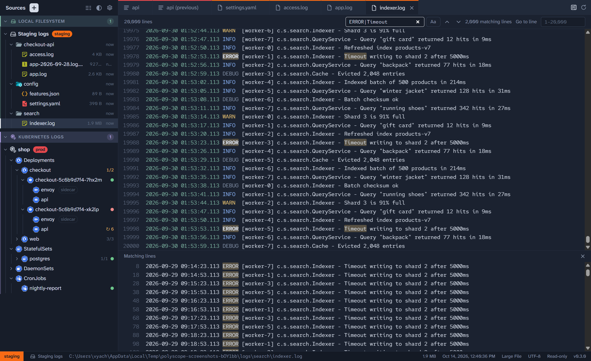

# Reading files and logs

Everything opens read-only in the viewer on the right, in the same editor that powers VS Code.

## Tabs

- **Click** a file or container to **preview** it. A preview tab (in italics) is replaced by the next one you preview.
- **Double-click** it, or double-click its tab, to keep it open in a tab of its own.
- Right-click a tab for **Reload**, **Follow** (for files that can grow), **Close**, **Close Others** and **Close All**.
- The buttons at the right of the tab bar show or hide the **Minimap**, and **Reload** the active tab.

Each tab carries its Source's Environment colour. The status bar shows the active tab's Environment, Source and path, and for files its size, modified time, encoding and language.

## Files

Polyscope highlights a file by its name: YAML, JSON, XML, source code, and logs, whose levels (`INFO`, `WARN`, `ERROR`…), timestamps and numbers are coloured. It also handles:

- **Compressed files**: `.gz` and `.zst` files are shown decompressed, highlighted by the name inside (`app.log.gz` as a log).
- **Encodings**: the encoding is detected. Click it in the status bar to reopen the file as UTF-8, UTF-16 or Latin-1.
- **Language**: click it in the status bar to highlight the file as another language.
- **Binary files**: shown as a size, with **Show as hex** to see the bytes.
- **Wrap**: the **Wrap** button at the top right wraps long lines.

To watch a growing file on a Local Filesystem, SSH Files or Kubernetes Files Source, turn on **Follow** from its tab's menu, or right-click it in the sidebar. New lines appear as they're written.

### Save a copy

To keep a file on your computer, say to attach it to a bug report or keep it before it rotates away, right-click it in the sidebar, or use the button at the top of the file, and choose **Save a copy…**. It works for files from every kind of Source. Polyscope asks where to save it, suggesting the file's name in your Downloads folder.

- The copy has the file's bytes exactly as they're stored: a `.gz` or `.zst` file stays compressed.
- A bar at the foot of the window shows how it's going. A large file is read a piece at a time, so it doesn't fill up memory. **Cancel** stops the save.
- A save that's cancelled, or that fails partway (say, when the connection drops), leaves nothing behind and says why. A file you chose to replace stays as it was.
- Only the place you chose is written to. Polyscope never changes the Source itself.

## Logs

A container's log, a CloudWatch log, or a systemd unit's journal opens with a toolbar:

- **Last N lines**: how much of the log to fetch and keep: 1K, 10K (the default, set in **Settings**), 50K, 100K, **All**, or a number you type. Choosing **All** for a log over the Large File threshold asks first.
- **Since**, for Docker and Kubernetes containers, CloudWatch logs and systemd units: show only the lines logged since a time: **Any time** (the default), **15 min**, **1 h**, **6 h** or **24 h** ago, or a date and time you type, like `2026-10-18 09:00`, or a time alone, like `09:00`, for today. It's read in local time or, with **UTC** on, in UTC. **Last N lines** still caps how many lines show, and **All** shows every line since then, asking first only if those are over the Large File threshold. **Follow** goes on from the last line shown, and a Kubernetes container's **Previous Log** shows only its lines since then too. Each new tab starts at **Any time**.
- **Load earlier**, for CloudWatch logs: add the lines before the first one shown, as many as **Last N lines** says. With a **Since**, it goes back only as far as the Since, and once it gets there it's no longer offered: there's nothing earlier to show.
- **Follow**: show new lines as they're logged. **Pause** holds new lines back while you read, and **Resume** shows them.
- **Previous**: show the container's **Previous Log**, the log of its run before it last restarted, in the same tab, marked "(previous)". It has ended, so there's nothing to Follow; turn **Previous** off to go back to the current log, Following it again. It's available once the container has restarted, which a Follow notices as it happens; Kubernetes keeps only the run just before the current one, and not always that.
- **Timestamps**: start each line with when it was logged, in local time or, with **UTC**, in UTC.
- **Wrap**: wrap long lines.
- **Save a copy…**: keep the log on your computer, say to attach it to a bug report. See below.

While following, the log marks what happened in line: a container restarting, the connection dropping and recovering, or the container, pod, CloudWatch log or Source going away.

### Save a copy of a log

**Save a copy…** in the log toolbar saves exactly the lines the tab shows when you choose it, one per line, to a place on your computer. It's there for container logs, CloudWatch logs, systemd units' journals and followed files alike.

- It includes lines a **Follow** has added and lines **Load earlier** has added, in the order shown. While **Paused**, the lines held back aren't included until you **Resume**.
- What a Follow marks in line, like a container restarting or the connection dropping, is saved as it's shown, among the lines.
- Timestamps are included only when **Timestamps** is on, in the time shown: local time, or UTC with **UTC** on.
- A **Previous Log** saves the Previous Log.
- Polyscope asks where to save it, suggesting a name in your Downloads folder that says what the log is of and when it was saved, like `web-7d9f-nginx-2026-10-18-090507.log` for a Kubernetes pod's container, marked `-previous` for a Previous Log.
- It's saved as a file's copy is: a bar at the foot of the window says when it's done, and a save that fails leaves nothing behind.

## Large Files

A file over the **Large File threshold** (50 MB by default) opens in the **Large File Viewer** instead of the editor. It shows the end of the file straight away, then caches the whole file on disk, with its progress shown at the top. Once it's cached:

- **Go to line** (<kbd>Ctrl</kbd>+<kbd>G</kbd>) jumps to any line. <kbd>Ctrl</kbd>+<kbd>Home</kbd> and <kbd>Ctrl</kbd>+<kbd>End</kbd> go to the start and end.
- **Search** (<kbd>Ctrl</kbd>+<kbd>F</kbd>) searches the whole file with a regular expression, optionally matching case. It lists every matching line to pick from. <kbd>Enter</kbd> and <kbd>Shift</kbd>+<kbd>Enter</kbd>, or <kbd>F3</kbd> and <kbd>Shift</kbd>+<kbd>F3</kbd>, step through the matches.
- **Open anyway in editor** opens it in the full editor, for files up to the **"Open anyway" limit** (200 MB by default).

## Settings

Open **Settings** with the gear at the top of the sidebar, or <kbd>Ctrl</kbd>+<kbd>,</kbd> (<kbd>⌘</kbd>+<kbd>,</kbd> on macOS).

| Setting | Default | What it does |
| --- | --- | --- |
| Theme | Dark | Dark or light. The half-circle button at the top of the sidebar switches it too. |
| Large File threshold | 50 MB | Larger files open in the Large File Viewer. |
| "Open anyway" limit | 200 MB | Large Files up to this size can still be opened in the editor. |
| Local cache size | 2048 MB | The Large File cache. The least recently used files are removed beyond this. |
| Default "Last N lines" | 10,000 | How many lines a log fetches and keeps, unless you choose another number. |

**Settings** is also where you manage Environments, check for updates, and copy diagnostics for a bug report.

## Keyboard

Polyscope can be used without a mouse. On macOS, use <kbd>⌘</kbd> for the shortcuts marked <kbd>Ctrl</kbd>/<kbd>⌘</kbd>.

| Keys | Does |
| --- | --- |
| <kbd>Ctrl</kbd>/<kbd>⌘</kbd>+<kbd>0</kbd> | Move to the sidebar |
| <kbd>Ctrl</kbd>/<kbd>⌘</kbd>+<kbd>1</kbd> | Move to the viewer |
| <kbd>Ctrl</kbd>/<kbd>⌘</kbd>+<kbd>,</kbd> | Open Settings |
| <kbd>↑</kbd> <kbd>↓</kbd> <kbd>Home</kbd> <kbd>End</kbd> | Move through the sidebar's rows |
| <kbd>→</kbd> / <kbd>←</kbd> | Expand / collapse a Source, folder, Workload or pod |
| Typing a name | Jump to the next row starting with it |
| <kbd>Space</kbd> | Preview the file or log |
| <kbd>Enter</kbd> | Open it in a tab of its own |
| <kbd>Ctrl</kbd>+<kbd>Tab</kbd> / <kbd>Ctrl</kbd>+<kbd>Shift</kbd>+<kbd>Tab</kbd> | Next / previous tab (also <kbd>Ctrl</kbd>+<kbd>PageDown</kbd> / <kbd>PageUp</kbd>) |
| <kbd>Ctrl</kbd>/<kbd>⌘</kbd>+<kbd>W</kbd> or <kbd>Ctrl</kbd>+<kbd>F4</kbd> | Close the tab |
