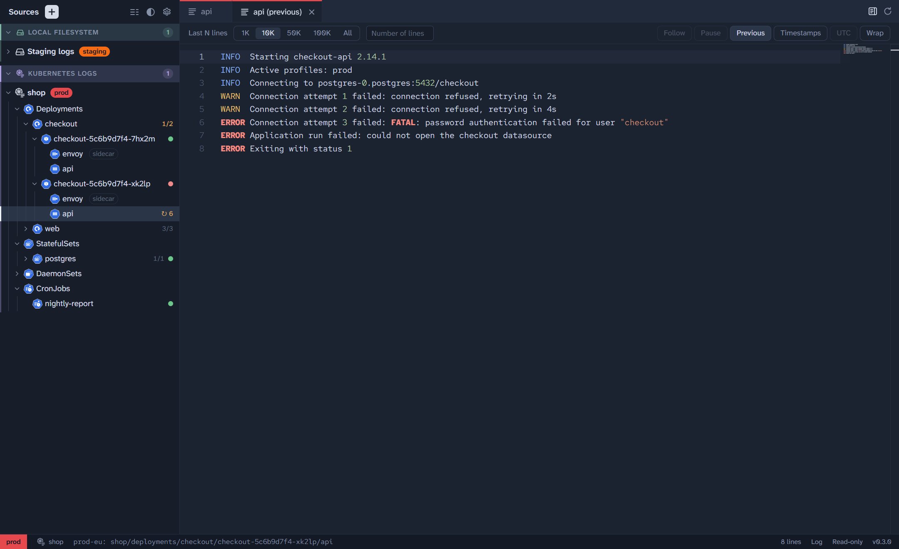

# Sources

A **Source** is one place Polyscope reads from: a folder, a folder on a server, a bucket, a blob container, a Workload's files, a namespace's logs, or a Docker engine's container logs. You configure each one once, give it a name, and it stays in the sidebar, grouped by its Source Type.

To add one, choose **+** next to **Sources** at the top of the sidebar, pick a **Source Type**, and fill in the rest. **Test connection** checks the settings without saving anything.

## Connecting

Every Source starts **disconnected** when Polyscope opens. Expanding it connects it. If it can't connect, the Source shows why, with a **Retry** button. Tabs aren't restored from one launch to the next, so each session starts clean.

Point at a Source's row to see its actions:

- **Refresh** lists it again. Right-click any folder or Workload to refresh just that part of the tree.
- **Disconnect** stops every live Follow of the Source but leaves its tabs open, with a **Reconnect** button.
- **Edit…**, **Duplicate** and **Delete…**. Deleting a Source forgets its settings and any secrets stored for it. What it points at is never touched.

Drag a Source to reorder it within its group. Click a group's header to collapse or expand it; a collapsed group still shows how many Sources it holds, and stays collapsed the next time you open Polyscope. The first of the icons at the top right of the sidebar shows or hides file sizes and modified times.

## Local Filesystem

A folder on this machine or, on Windows, a UNC share (`\\server\share\logs`).

- **Root path**: the folder to browse. **Browse…** picks it.
- **Show hidden files**: dotfiles, and files marked hidden on Windows.

In VS Code, a UNC share's server has to be in the `security.allowedUNCHosts` setting (as `"server"`, without backslashes), or VS Code blocks it. Restart VS Code after adding it. Setting `security.restrictUNCAccess` to `false` allows every server, but turns off that VS Code protection.

Files that are still growing can be **followed** live. Polyscope notices when a followed file is truncated or rotated and carries on from the new file's start.

## SSH Files

A folder on a server, read over SFTP: an app's logs under `/var/log` or `/opt/app/logs` on a VM, say. Polyscope uses its own SSH client, not your `ssh` command, and needs nothing on the server but its SFTP subsystem, which OpenSSH's `sshd` turns on by default.

- **Host**: the server's host name or address, or a `Host` alias from your `~/.ssh/config`. The field suggests the aliases there.
- **Port**: 22 unless you or your SSH config say otherwise.
- **User**: who to sign in as. Leave it blank to use the `User` from your SSH config.
- **Path**: the absolute path of the folder to browse, like `/var/log`.
- **Sign in with**:
  - **SSH agent**: the keys in your SSH agent. Polyscope asks the agent at `SSH_AUTH_SOCK`, and on Windows also Pageant and then the OpenSSH Authentication Agent (whose pipe 1Password's agent answers on too). Your private keys never leave the agent.
  - **Key file**: a private key file, chosen with **Browse…**. Leave it blank to use the `IdentityFile` from your SSH config. If the key is encrypted, enter its **Passphrase**.
  - **Password**: for servers that allow only passwords.

  Passphrases and passwords are stored encrypted by your operating system's secure storage (see [Privacy](privacy.md) for Linux without a keyring). **Edit…** keeps a stored one unless you type a new one, and **Duplicate** copies it.

Each Source keeps one SSH connection open while it's connected, shared by all its tabs and Follows. If the connection drops, say while your laptop slept, the next thing you browse or read reconnects it. **Disconnect** closes it.

### What Polyscope reads from your SSH config

Polyscope reads `~/.ssh/config`, and the files it `Include`s, the way `ssh` does: the first value found for a host wins, and `Host` patterns can use `*`, `?` and `!`. It uses only these options:

- `HostName`, `User`, `Port` and `IdentityFile`;
- `ProxyJump`, to reach a server through one or more bastions. Each bastion is signed in to the same way as the server, and its host key is checked too.

It ignores every other option, and skips `Match` blocks (other than `Match all`) along with everything in them. A host that needs `ProxyCommand` gets an error naming it, as Polyscope can't run one. Polyscope never writes to your SSH config or anything else in `~/.ssh`.

### Host keys

Polyscope checks every server's host key before signing in, as `ssh` does:

- A key in your `~/.ssh/known_hosts` (hashed entries included) is trusted without asking, so servers you already use just work.
- A server Polyscope hasn't seen before shows its key's type and SHA-256 fingerprint. **Test connection** offers **Trust and test again**; expanding the Source offers **Trust host key…**. Check the fingerprint with the server's administrator before you trust it.
- A server whose key isn't the one known for it is refused, with no way to carry on: someone may be impersonating it. If the key changed for a good reason, say the server was rebuilt, remove its old key from `known_hosts` (`ssh-keygen -R host`).

The keys you trust in Polyscope are kept in Polyscope's own data folder, never added to your `known_hosts`. Deleting the last Source on a server forgets the key you trusted for it; keys trusted for bastions are kept.

### Following and permissions

Files on an SSH Files Source open, page and search like a Local Filesystem Source's, Large Files included: a multi-gigabyte log shows its end straight away, then is cached on this computer in the background for paging and search (see [Large Files](reading.md#large-files)). Growing files can be **followed**, and a followed file that's truncated or rotated is picked up from the new file's start. If the connection drops while following, the tab says so and the Follow stops.

Polyscope reads files as the user it signs in as, without `sudo`. Most logs under `/var/log` are readable only by `root` and the `adm` group, so a file you can't read says so. Adding your SSH user to `adm` (`sudo usermod -aG adm <user>`, then **Disconnect** the Source and expand it again, so it signs in afresh) lets it read most of them.

## S3-compatible Storage

A bucket on AWS S3, MinIO, Ceph, or any other S3-compatible store.

- **Host**: the store's address, like `https://minio.internal:9000`. Leave it blank for AWS.
- **Bucket**, and an optional **Prefix** to browse only the keys under it, like `logs/app`.
- **Region**, and **Path-style addressing**, which MinIO and most self-hosted stores need. It's on for new Sources.
- **Sign in with**:
  - **Access keys**: an access key and secret key. The secret key is stored encrypted by your operating system's secure storage (see [Privacy](privacy.md) for Linux without a keyring).
  - **AWS profile**: a profile from your AWS config and credentials files, or the default credential chain. An SSO profile needs you to have run `aws sso login` recently.
- **CA bundle**: a PEM file of extra CA certificates to trust, for stores with a private CA.
- **Verify TLS certificates**: turn it off only when you must. The Source shows a **TLS** warning while it's off.
- **Proxy**: like `http://proxy.corp:3128`. Otherwise `HTTPS_PROXY` and `NO_PROXY` apply.

S3 objects don't grow, so they can't be followed.

## Azure Blob Storage

A container in an Azure storage account, Data Lake Gen2 ones (with a hierarchical namespace) included. Blobs are shown as folders and files split on `/`, as S3 keys are.

- **Sign in with**:
  - **Connection string**: the storage account's, from its **Access keys** page in the Azure portal. It's stored encrypted by your operating system's secure storage, like an S3 secret key.
  - **SAS**: a SAS URL or token, stored the same way. Pasting a SAS URL fills in the account and container. It needs the **List** and **Read** permissions, and the Source says so when it has expired.
  - **Azure CLI**: signs in as you, with Azure's default credentials: your `az login`, `AZURE_*` environment variables, or a managed identity on an Azure VM. Polyscope stores nothing. Your identity needs the **Storage Blob Data Reader** role on the account or container; the Source names the role when it's missing, and tells you to run `az login` again when your sign-in has expired.
- **Storage account** and **Container**, and an optional **Prefix** to browse only the blobs under it, like `logs/app`.
- **Blob endpoint**, signing in with a SAS token or Azure CLI: for Azure Government (`https://<account>.blob.core.usgovcloudapi.net`), Azure in China (`https://<account>.blob.core.chinacloudapi.cn`) or the Azurite emulator (`https://127.0.0.1:10000/devstoreaccount1`). Leave it blank for Azure's own. A connection string or SAS URL says where its endpoint is itself.
- **CA bundle**: a PEM file of extra CA certificates to trust, for TLS inspection by a private CA.
- **Proxy**: like `http://proxy.corp:3128`. Otherwise `HTTPS_PROXY` and `NO_PROXY` apply.

The proxy and CA bundle are for reaching the storage account. Signing in through Azure CLI, getting a token goes through `HTTPS_PROXY` and the CAs Node.js trusts (`NODE_EXTRA_CA_CERTS`), or Azure CLI's own settings, not these.

Gzip and zstd blobs open decompressed, and a blob over the Large File threshold opens end-first, read in ranges. Blobs don't grow, so they can't be followed.

In VS Code, a connection string or SAS is kept in VS Code's SecretStorage, and under Remote-SSH, WSL or Dev Containers, **Azure CLI** signs in with the remote machine's `az login` and environment, as an S3 Source uses its AWS profiles.

## Kubernetes Files

The files in one folder inside the pods of one Workload, read over `exec` the way `kubectl exec … cat` would.

- **Context**: from your kubeconfig. Polyscope reads the one `kubectl` uses (`KUBECONFIG`, or `~/.kube/config`), and auth plugins like `aws` or `kubelogin` work as they do for `kubectl`.
- **Namespace**: where the Workload is. It suggests the cluster's namespaces as you type.
- **Workload**: a Deployment, StatefulSet or DaemonSet in that namespace.
- **Path**: the absolute path of a folder in the containers, like `/var/log`. It suggests where the Workload's volumes are mounted.

When the Workload has several pods, each shows as a folder of its own, since each pod's volumes can differ. With only one pod, the Source lists that pod's files directly, and hovering over the Source shows which pod it is and how it's doing. If that pod is replaced, say by a rollout, refreshing the Source lists its replacement. Pods with several containers get a folder per container. Files are listed and read with `sh` and basic tools like `stat`, so containers without them (distroless images, for example) can't be browsed.

## Kubernetes Logs

Every container log in one namespace, laid out the way the cluster runs them.

- **Context** and **Namespace**, as for Kubernetes Files.

The tree groups the namespace's Workloads: **Deployments**, **StatefulSets**, **DaemonSets**, **CronJobs** (with their Jobs), **Jobs**, and any **Pods** no Workload owns. Along the way it shows:

- each Workload's **Ready Count**, like `1/2`;
- each pod's health as a coloured dot, with its status (`Running`, `CrashLoopBackOff`, `OOMKilled`…) and restarts in its tooltip;
- **init** and **sidecar** badges on the containers that start first;
- a restart count on a container that has restarted, with why it last ended (`Error`, `OOMKilled`…) in its pod's tooltip.

A level with only one thing in it folds into the row above:

- A pod with only one container doesn't expand: clicking the pod opens that container's log, and its tooltip names the container.
- A Workload or Job with only one pod stands in for that pod: it shows the pod's health dot (and restarts, if the pod has one container) after its Ready Count, and its tooltip names the pod. With one container too, clicking the Workload opens that container's log; with several, it expands straight to the containers.
- A CronJob that has run only one Job stands in for that Job, and so for its pod too, if it has just the one.

The groups (**Deployments**, **CronJobs**…) always expand, however few Workloads they hold. When things change, say a rollout or scaling replaces or adds pods, or a sidecar is added, choose **Refresh** on the row to bring the tree up to date: a Workload that now has several pods expands to list them, and one that's back to one pod folds it in again. Logs already open stay with the pod and container they were opened from. A Workload scaled down to no pods, or a CronJob that hasn't run yet, doesn't expand at all; choose **Refresh** on it once it has.

Right-click a Workload, pod or container for **Copy name**, to paste it into `kubectl`, say. A row standing in for a Job, pod or container also offers to copy that one's name, like **Copy pod name**.

Click a container to read its log, or turn on **Follow** to watch it live. Once a container has restarted, turn on **Previous** in its log's toolbar to read its **Previous Log**, the log of its run before the last restart, and off again to go back. See [Reading files and logs](reading.md#logs).



## Docker Logs

Every container log on one Docker engine, running or stopped, grouped the way Docker Compose runs them. It reads the engine's API directly, so it doesn't need the `docker` command, and never starts, stops or changes a container.

- **Context**: which engine to read, from the contexts the Docker CLI knows (`docker context ls`). **default** reaches the engine `docker` reaches when you don't name a context. That's the engine `DOCKER_HOST` names if it's set, or else the context `DOCKER_CONTEXT` names, or else the CLI's current context (`docker context use`), or else the local engine: its socket, or its named pipe on Windows. Pick a context by name to always use that one. The field's hint shows where the context's engine is.

A new Source is named after its context (**Docker** for **default**). **Test connection** reaches the engine and tells its version, like `Docker Engine 27.3.1` or `Podman Engine 5.2.0`.

### Contexts and engines

Polyscope reads the contexts in the Docker CLI's config folder: `DOCKER_CONFIG`, or else `~/.docker`. Make one with `docker context create`. It can reach an engine:

- **on this machine**, over a `unix://` socket or, on Windows, an `npipe://` named pipe;
- **over SSH**, as `ssh://user@host` (see below);
- **over TCP**, as `tcp://host:2376`. If the context has TLS material (made with `docker context create … --docker "host=tcp://…,ca=…,cert=…,key=…"`), Polyscope uses its CA, certificate and key, as `docker` does. With no CA, it trusts your operating system's CAs. With `skip-tls-verify`, it doesn't check the engine's certificate. Without TLS, it speaks plain HTTP, which anyone on the network can read, so keep that to engines on your own machine. A `DOCKER_HOST=tcp://…` with `DOCKER_TLS_VERIFY=1` uses the `ca.pem`, `cert.pem` and `key.pem` in `DOCKER_CERT_PATH`, or else in the config folder, as `docker` does.

An **`ssh://` context** (made with `docker context create … --docker "host=ssh://user@host"`) reaches the engine on that host through the same SSH client as [SSH Files](#ssh-files), not your `ssh` command. Picking one shows **Sign in with**, as for an SSH Files Source: **SSH agent** (the default), **Key file** with its **Passphrase**, or **Password**. The context's host can be a `Host` alias from your `~/.ssh/config`, whose `HostName`, `Port`, `User`, `IdentityFile` and `ProxyJump` are used as for SSH Files (see [What Polyscope reads from your SSH config](#what-polyscope-reads-from-your-ssh-config)), and its host key is checked the same way: one that isn't known yet is offered for you to trust ([Host keys](#host-keys)). On the host, Polyscope runs `docker system dial-stdio`, as the Docker CLI does, so the host needs the `docker` command on the PATH a command run over SSH gets, and the user you sign in as needs to be allowed to use the engine there, usually by being in the `docker` group. If either is missing, the Source says which.

The Source keeps one SSH connection to the host while it's connected, shared by all its tabs and Follows. If it drops, the next thing you expand or open reconnects it, and Follows going on stop, saying the connection was lost. An OpenSSH server lets a connection run 10 commands at once by default (`MaxSessions`), and each Follow takes one, so following more than about six containers on one host at once needs `MaxSessions` raised there.

**Docker Desktop** on Windows and macOS works with **default**: Docker Desktop makes its own context (`desktop-linux`) the current one, or serves the usual socket or pipe. **Colima**, **Rancher Desktop** and **OrbStack** set up a context of their own too, so picking it, or leaving **default** while it's current, works the same way.

**Podman** works through its Docker-compatible socket. Start it with `systemctl --user enable --now podman.socket` on Linux (on macOS and Windows, `podman machine start` serves it). Then either make a context for it:

```sh
docker context create podman --docker "host=unix://$XDG_RUNTIME_DIR/podman/podman.sock"
```

or set `DOCKER_HOST` to that socket in the environment Polyscope starts in, and leave the Context on **default**. An app opened from the Dock, Finder or a desktop launcher doesn't get the variables your shell sets, so a context is the surer way. On macOS, `podman machine inspect` shows the socket's path. Containers made by `podman compose` are grouped by their Compose labels, as Docker's are.

On Linux, using the engine's socket takes permission. If the Source says it isn't allowed to use the socket, add yourself to the `docker` group (`sudo usermod -aG docker $USER`), then sign out and back in.

### The tree

The tree groups containers by **Compose project**, then by **service**. Containers that Compose didn't start go under **Standalone**, after the projects. Stopped and exited containers are listed too, so you can read the log of the one that crashed.

As in Kubernetes Logs, a level with only one thing in it folds into the row above. A service with one container opens that container's log when clicked, and a project with one service stands in for it. **Standalone** always expands. Choose **Refresh** on a row to pick up new or removed containers.

Each container shows its **Container Status** as a coloured dot, with the status in its tooltip:

- **Running**, or **Exited (code)** once it has stopped (**OOMKilled** if it ran out of memory);
- **Restarting** while the engine restarts it, **Paused**, or **Dead**;
- **Unhealthy** while its healthcheck fails, or **Starting** until the healthcheck first passes;
- **Created** or **Removing** on the way in or out.

A container that has restarted shows how many times, as in Kubernetes Logs. Its tooltip also gives its image and when it started, or when it exited. Right-click a row for **Copy name**, to paste into `docker logs`, say.

### Reading and following

Click a container to read its log, with the same toolbar as any log: **Last N lines**, **Timestamps**, **Wrap** and **Follow**. stdout and stderr show together, in the order they were written. A container with a TTY has its log shown as it was written. See [Reading files and logs](reading.md#logs).

Docker keeps every run of a container in one log, so there's no **Previous** toggle. A Follow carries on when the container restarts instead: it marks the restart in the log and goes on with the next run. When the container exits for good, the Follow says so and stops. If the container is removed, its tab keeps what it showed, with a note that it's gone.

### Log drivers

Polyscope reads a log the way `docker logs` does, so only from engines that keep a copy of it. The `json-file`, `local` and `journald` drivers always do. Others (`syslog`, `gelf`, `fluentd`, `awslogs`, `splunk`…) send the log elsewhere, and are readable only while Docker's dual logging keeps a local copy, which is on unless it was turned off. When there's no copy, or the driver is `none`, the log says so and names the driver, so you know where the log went.

## Environments

An **Environment** labels a Source with what kind of system it points at. Its colour shows next to the Source in the sidebar, on its tabs, and at the left of the status bar, so a production log never passes for a staging one.

Polyscope starts with **prod**, **staging**, **qa** and **dev**. Choose one in a Source's **Environment** field, or open **Manage…** there (or **Settings → Manage Environments…**) to add, rename, recolour or delete them. You can also mark an Environment **Protected**, like prod, as one that needs extra care.
